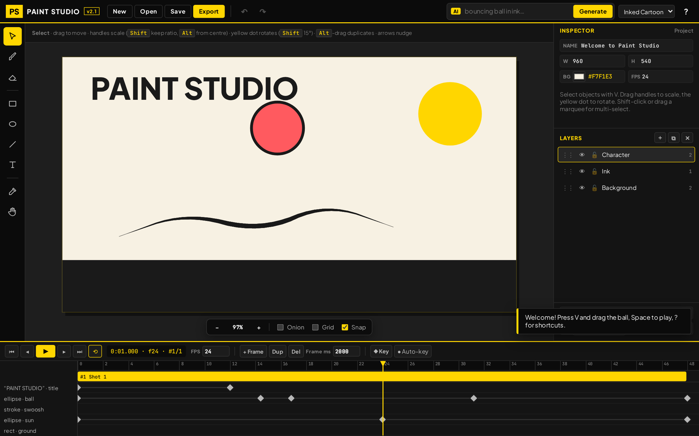
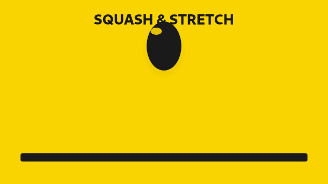
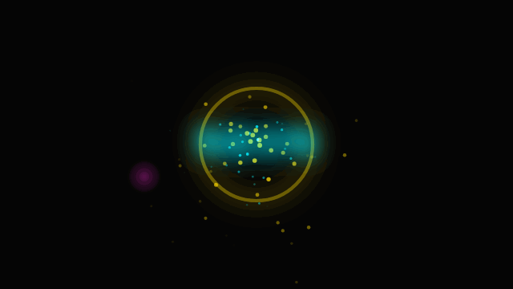
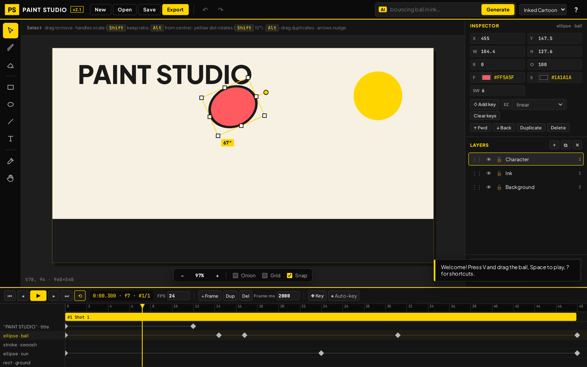

<p align="center">
  
</p>

<h1 align="center">Paint Studio</h1>

<p align="center"><b>Animate with any LLM.</b></p>

<p align="center">
  Open-source animation studio for humans and coding agents. Author <code>.paint.json</code>, render GIF/PNG headlessly, drive it via CLI / MCP / JS API — same TypeScript core everywhere. Bold black &amp; yellow editor included.
</p>

<p align="center">
  <a href="https://mazin7d4.github.io/PaintWebApp/">Live demo</a> ·
  <a href="AGENTS.md">AGENTS.md</a> ·
  <a href="schemas/paint-project.schema.json">JSON Schema</a> ·
  <a href="examples/">Examples</a>
</p>

<p align="center">
  
  
  
</p>

<p align="center">
  
</p>

## Why

Coding agents should be able to **produce real animations** — not just screenshots of a paint toy. Paint Studio gives them:

1. A **versioned JSON document** (layers, frames, brushes, keyframes, camera)
2. A **headless CLI** (`check` → `render`) that exports GIF / PNG / sprite sheets
3. A **shared renderer** so the editor preview matches the CLI output
4. **Style presets + brush engine** so results look intentional (ink, neon, pixel, painterly…)

## Quick start (one build)

```bash
npm install && npm run build

# Prompt → animation → GIF (no API key; template provider)
node packages/cli/dist/bin.js generate "neon logo pulse" -o shot.paint.json
node packages/cli/dist/bin.js check shot.paint.json
node packages/cli/dist/bin.js render shot.paint.json -o shot.gif

# Editor
npm run dev
```

### Copy-paste prompts for your LLM

```
Using Paint Studio, create examples/fox-run.paint.json in inked-cartoon style:
a simple running cycle hint with squash/stretch on a character blob,
then run: node packages/cli/dist/bin.js check ... && node packages/cli/dist/bin.js render ... -o fox.gif
```

```
npx paint-studio generate "bouncing ball squash and stretch" -o ball.paint.json --provider template
npx paint-studio render ball.paint.json -o ball.gif
```

Bring-your-own-key (OpenAI-compatible, Anthropic, or Ollama):

```bash
node packages/cli/dist/bin.js generate "a fox running through snow, inked style" \
  -o fox.paint.json --provider openai --model gpt-4o-mini
# uses OPENAI_API_KEY — never commit keys
```

## Example gallery (CLI-authored)

| Animation | Style | Command |
|-----------|-------|---------|
| Ink logo reveal | `inked-cartoon` | `render examples/ink-logo-reveal.paint.json` |
| Squash & stretch ball | `flat-vector` | `render examples/bouncing-ball.paint.json` |
| Neon pulse | `neon` | `render examples/neon-pulse.paint.json` |

<p align="center">
  
  
</p>

## Packages

| Package | Role |
|---------|------|
| `@paint-studio/core` | Project model, brushes, tweening, validator, renderer, prompt→project |
| `paint-studio` | CLI — create / check / generate / render / export-hyperframes |
| `@paint-studio/mcp-server` | MCP server for Claude / Cursor / Codex / etc. |
| `@paint-studio/web` | Vite editor (black/yellow), prompt box, `window.paintStudio` API |

### MCP

```bash
node packages/mcp-server/dist/server.js
# Tools: paint_create_project, paint_check_project, paint_generate_animation, paint_edit_project, paint_list_objects, paint_render
```

## Editor

<p align="center"></p>

- **Pro transforms**: select tool with bounding box, 8 resize handles and a rotate handle. Hold <kbd>Shift</kbd> to keep the ratio, <kbd>Alt</kbd> to scale from the centre, <kbd>Shift</kbd>-rotate to snap to 15°, and <kbd>Alt</kbd>-drag to duplicate. Snapping guides align to objects and the canvas. You also get marquee and shift-click multi-select, group scale/rotate, arrow-key nudge, and align buttons. The math stays exact for rotated objects.
- **Viewport**: hi-DPI canvas, wheel zoom toward the cursor, <kbd>Space</kbd>-drag or middle-mouse pan, fit/100% shortcuts.
- **Drawing**: pointer-event brushes (ink, pencil, marker, airbrush, charcoal, neon, watercolor) with pen pressure and coalesced events. Also rect, ellipse and line (with constraints), text, eraser and eyedropper.
- **Inspector**: numeric X/Y/W/H/rotation/opacity with scrubbable labels, fill/stroke/brush/text styling, keyframe toggle and easing per key, plus arrange, duplicate and delete.
- **Layers**: visibility, lock, opacity, blend mode, double-click rename, drag to reorder, duplicate and delete.
- **Timeline**: ruler scrubbing, frame cells, one keyframe track per object with draggable diamonds (right-click deletes), play/pause/loop, fps, frame duration, and **auto-key** mode.
- **Everything is undoable.** A whole drag is one undo step. Transforms on animated objects write keyframes at the playhead.
- **Export**: GIF, WebM (MediaRecorder), PNG, PNG-sequence `.zip`, sprite sheet + JSON, and `.paint.json` open/save. Autosave is on.
- Keyboard shortcuts everywhere (press <kbd>?</kbd>), toasts instead of alerts, and a starter scene on first visit.

## Agent workflow

See **[AGENTS.md](AGENTS.md)** for art direction, schema notes, and the create → check → render loop (inspired by [Hyperframes](https://github.com/heygen-com/hyperframes) agent UX — we keep MIT and our own canvas/GIF pipeline; optional HTML export for Hyperframes MP4).

## GitHub Pages

`.github/workflows/pages.yml` builds the Vite app and deploys it. This **supersedes** draft PRs #3/#4 (not modified here).

## License

MIT © Paint Studio contributors
